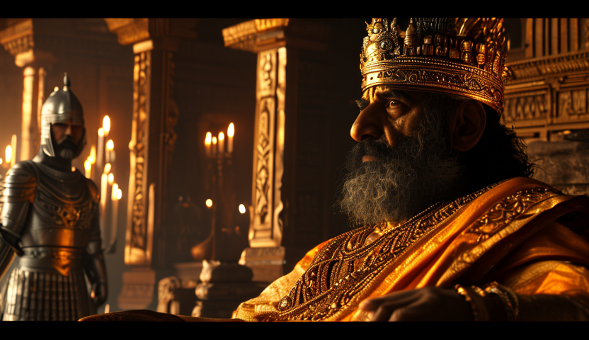

# Production AI Agents for Generative Media

Coursework, homework implementations, and multimodal agent pipelines for [DataTalks.Club's Production AI Agents for Generative Media](https://github.com/DataTalksClub/production-ai-agents-for-media-generation) course (Cohort 2026).

**Student:** Carlos Saritama  
**Platform Infrastructure:** Nebius AI Cloud (Serverless GPUs) & Nebius Token Factory (LLM APIs)  
**Cost Constraint:** $0.00 Out-of-Pocket (Strict sequential provisioning funded via Nebius promotional balance)

---

## Course Navigation & Submissions

| Module | Title | Deliverable Link | Primary Stack | Status |
| :--- | :--- | :--- | :--- | :--- |
| **01** | **Consistent Media Generation on Serverless GPUs** | [Homework 1](cohorts/2026/homework/01-consistent-media-generation-on-serverless-gpus/) | Sana 1.6B (fp16), NVIDIA® L40S spot, REST client | **SUBMITTED** |
| **02** | **Multi-Agent Media Workflows & Video Generation** | [Homework 2](cohorts/2026/homework/02-multi-agent-media-workflows/) | PydanticAI, Gemma 3 27B Vision Judge, Wan2.2-I2V (H100) | **READY / COMPLETED** |
| **03** | **Batch Workflows & Video Evaluation** | *Planned* | 10 Parallel Spot Jobs, Slurm/Job API | Planned |
| **Capstone** | **Autonomous Myth & Media Factory** | [Proposal Draft](cohorts/2026/homework/01-consistent-media-generation-on-serverless-gpus/) | Multi-agent orchestrated media pipeline | Planned |

---

## Module 2 Showcase: The Initiatic Mahabharata (Lesson 1)

An autonomous multi-agent media generation and review loop implementing **Lacanian Structural Psychoanalysis** and **José Luis Parise's 6 Master Keys**:

* **Keyframe Image Generation**: Sana 1.6B on NVIDIA® L40S spot ($0.79/h; 5.94s generation time; $0.00130 USD).
* **Multimodal Vision Judge**: `google/gemma-3-27b-it` on Nebius Token Factory (Score: **1.0 / PASS**; tokens: 953 in, 382 out; $0.00030 USD).
* **Video Generation**: Wan2.2-I2V-A14B on NVIDIA® H100 SXM 80GB spot ($0.84/h; 57.42s generation time; $0.01340 USD).
* **Marginal Cost per Video**: **$0.0151 USD**.
* **Trace Verification**: Strict JSONL tracing validated with **0 contract violations** via `check_trace.py`.

For full answers to Questions 1–10 and video assets, see [Homework 2 README](cohorts/2026/homework/02-multi-agent-media-workflows/README.md).

---

## Module 1 Showcase: The 10 Celestial Archetypes

An empirical benchmark evaluating generation latency and marginal compute costs on **NVIDIA® L40S** spot ($0.79/h):

* **Model**: `Efficient-Large-Model/Sana_1600M_1024px_diffusers` (1024x1024 PNG)
* **Median Generation Latency**: **3.74 seconds**
* **Projected Unit Cost at N = 1000**: **$0.0009 USD**
* **Breakeven vs Commercial APIs (Fal.ai @ $0.0050)**: Cheaper starting at **$N \ge 14$ assets** (over 82% cost reduction in production).

For complete technical methodology, full image gallery, and question-by-question submission details, see [Homework 1 README](cohorts/2026/homework/01-consistent-media-generation-on-serverless-gpus/README.md).
