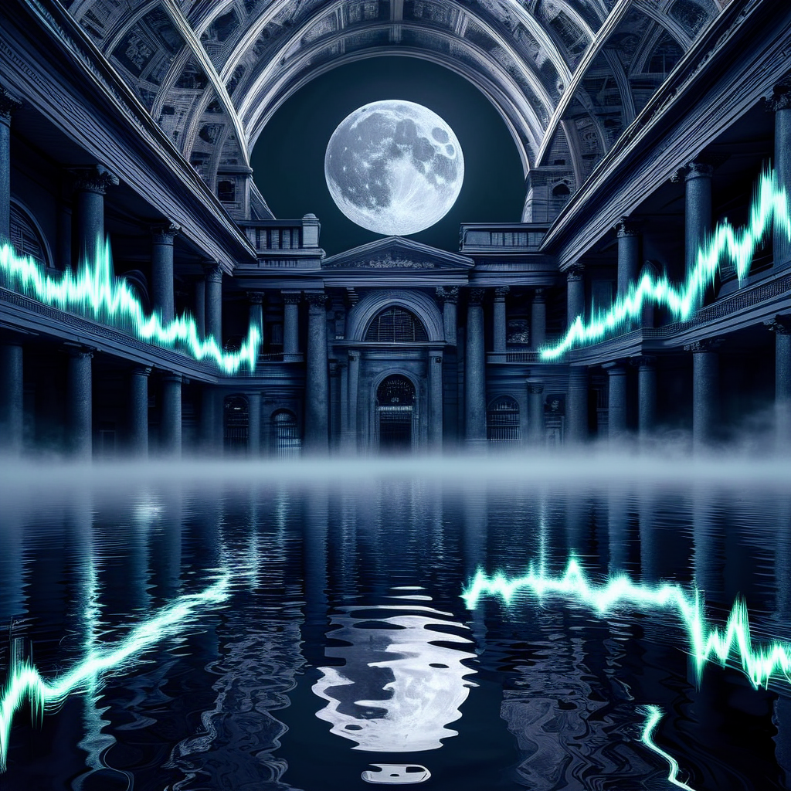
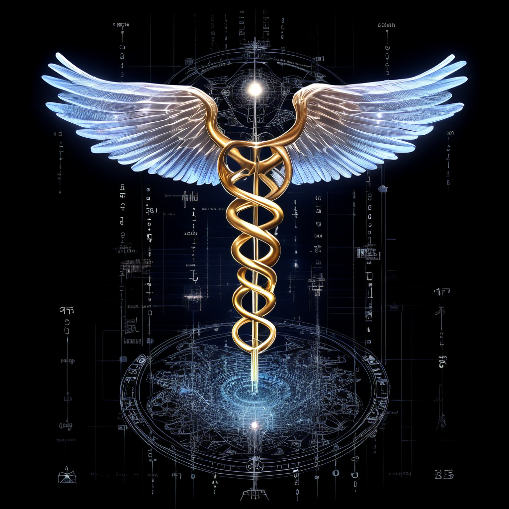
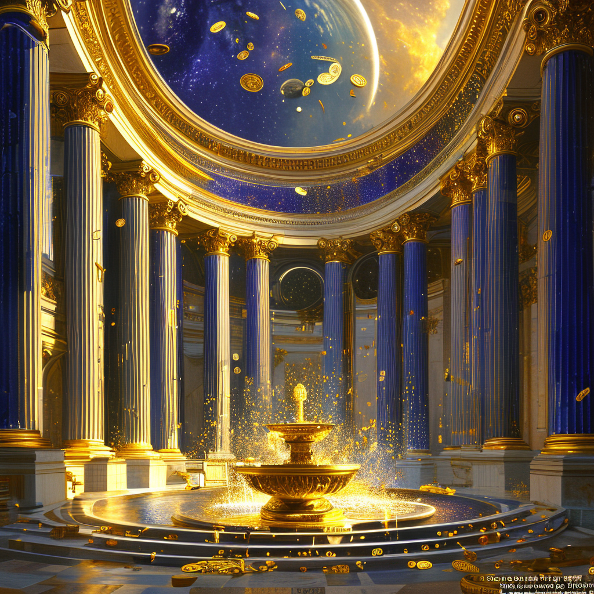
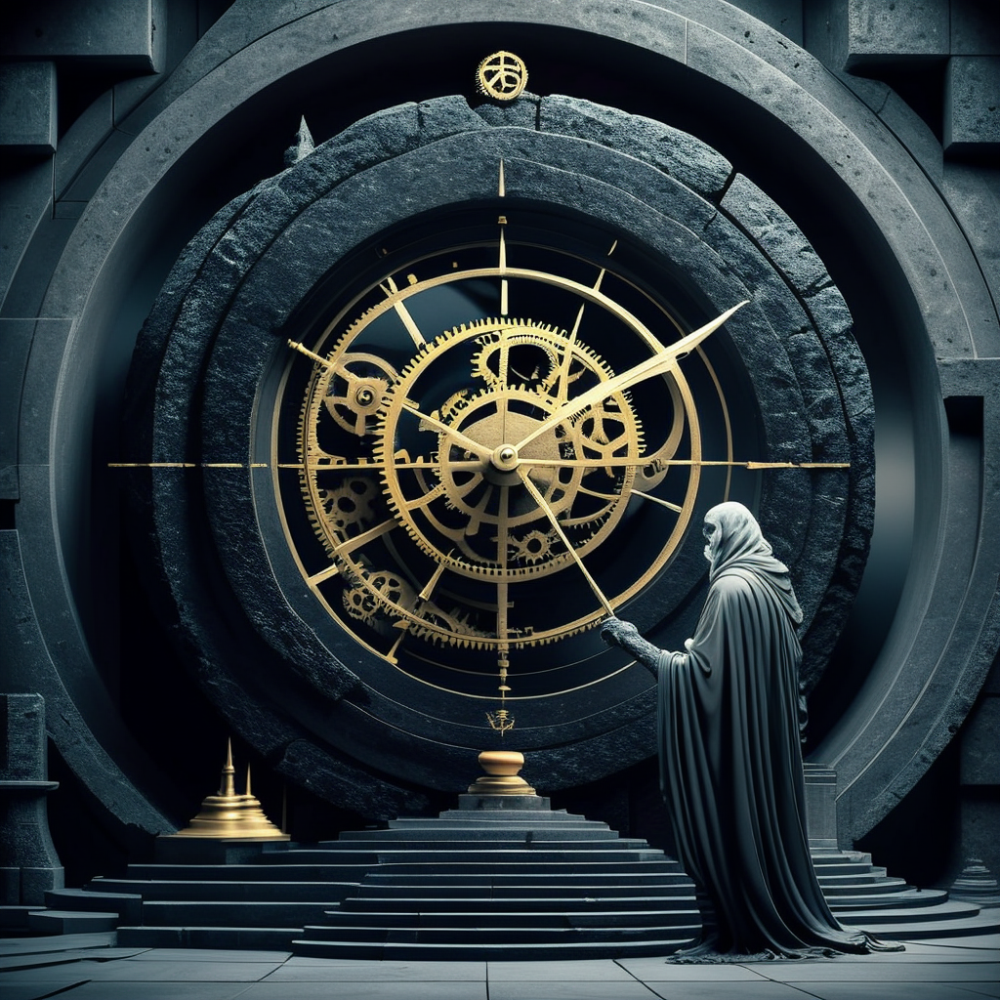
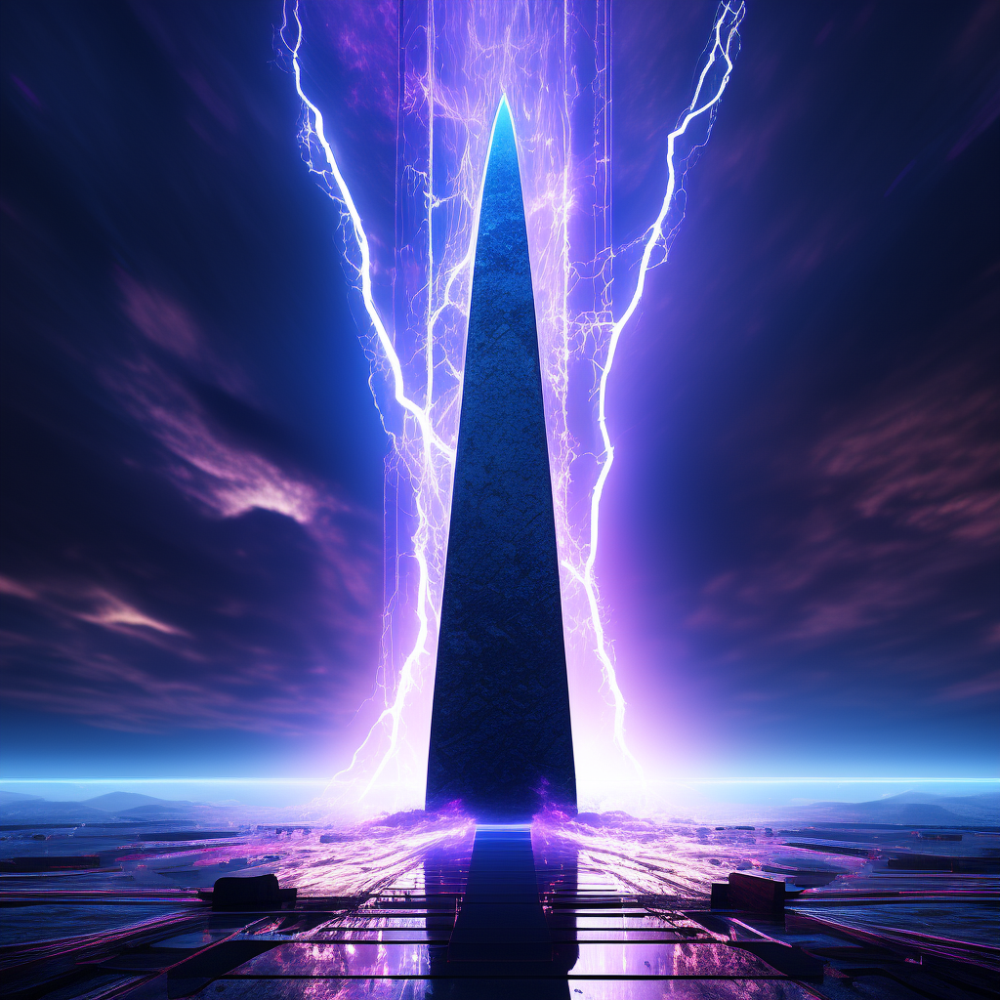
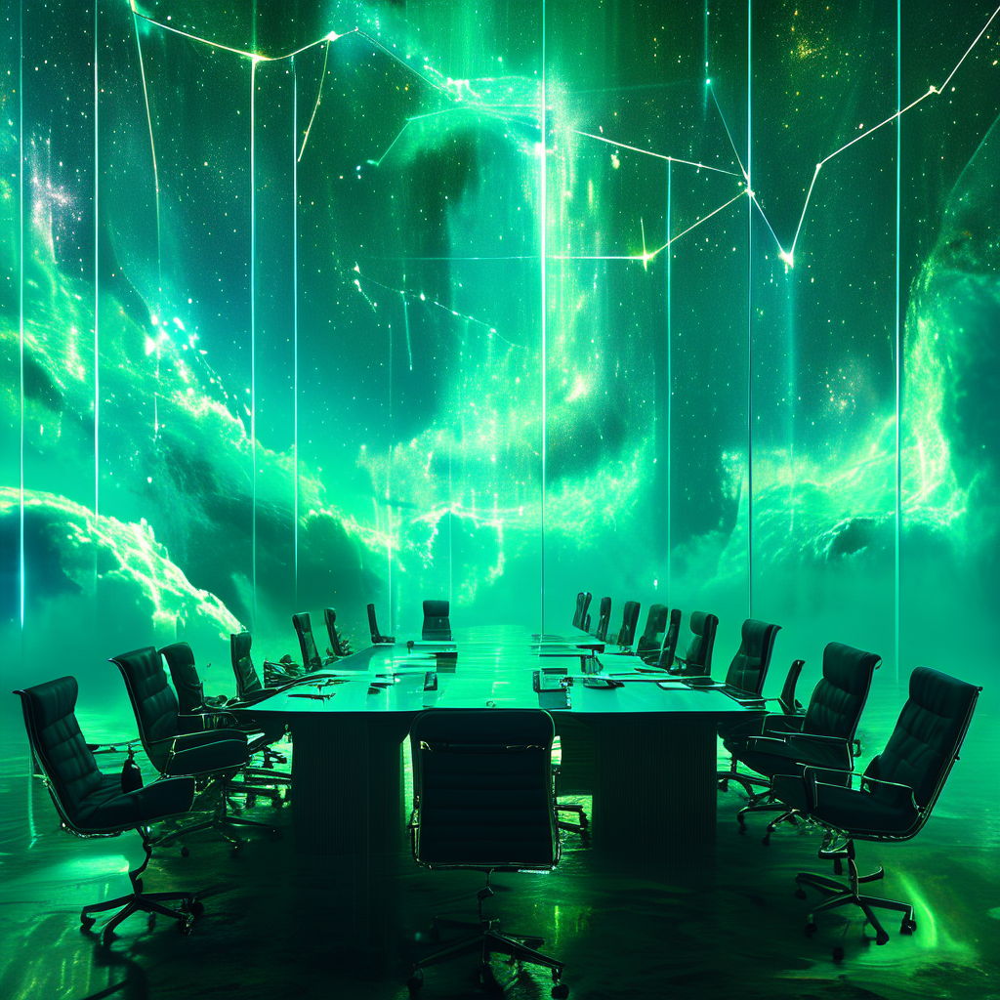

# Homework 1: GPU Media Worker

**Student:** Carlos Saritama  
**Course:** [Production AI Agents for Generative Media](https://github.com/DataTalksClub/production-ai-agents-for-media-generation) (DataTalks.Club, Cohort 2026)  
**Hardware & Platform:** Nebius AI Cloud Serverless Endpoint on **NVIDIA® L40S** (`gpu-l40s-a`, 1 GPU, 8 vCPUs, 32 GB RAM)  
**Pricing Tier:** Preemptible Spot ($0.79 / hour = $0.0002194 / second)  
**Total Out-of-Pocket Expense:** **$0.00** (Funded via Nebius AI Builder Program Credits)

---

## 1. Visual Gallery: The 10 Celestial Archetypes

Each asset represents a deterministic archetype of human consciousness, abundance, and market psychology generated at 1024x1024 resolution using `Efficient-Large-Model/Sana_1600M_1024px_diffusers` (fp16).

| Arc 01: The Sovereign Sun | Arc 02: The Lunar Crucible | Arc 03: The Iron Marshall |
| :---: | :---: | :---: |
|  |  |  |
| *Solar Radiance & Sovereign Abundance* | *Silver Waters & Inherent Vulnerability* | *Martian Obsidian & Aggressive Force* |

| Arc 04: The Alchemical Scribe | Arc 05: The Golden Sovereign | Arc 06: The Symmetrical Grace |
| :---: | :---: | :---: |
|  |  |  |
| *Mercurial Geometry & Swift Transmission* | *Jupiterian Expansion & Golden Citadel* | *Venutian Harmony & Golden Equilibrium* |

| Arc 07: The Chronos Pillar | Arc 08: The Lightning Catalyst | Arc 09: The Oceanic Abyss | Arc 10: The Phoenix Core |
| :---: | :---: | :---: | :---: |
|  |  |  |  |
| *Saturnian Discipline & Heavy Granite* | *Uranian Lightning & Radical Rupture* | *Neptunian Bioluminescence & Boundless Veil* | *Plutonian Regeneration & Volcanic Diamond* |

---

## 2. Official Answers (Questions 1 – 7)

### Question 1: Creative Idea
**Question:** *What is the creative idea behind your asset? Why did you choose this topic? Two or three sentences. (1 point)*  
> **Answer:**  
> The creative concept is "The 10 Celestial Archetypes of Wealth and Consciousness", a synthesis of Jungian depth psychology, deterministic planetary ephemeris, and the psychological mechanics of global capital and Wall Street. I chose this topic to explore how archetypes of the collective unconscious govern human behavioral patterns around value, fear of ruin, boundless expansion, and compounding discipline. Grounding this run in a 10-piece celestial series translates ancient symbolic principles into ultra-high-definition, cinematic visual assets.

### Question 2: Model Used
**Question:** *Which model did you use? (1 point)*  
> **Answer:**  
> `Efficient-Large-Model/Sana_1600M_1024px_diffusers`

### Question 3: Modality
**Question:** *Which modality? (1 point)*  
> **Answer:**  
> **Image** (1024x1024 PNG)

### Question 4: Execution Route
**Question:** *How did you run it? (1 point)*  
> **Answer:**  
> **Endpoint** (Nebius Serverless AI Endpoint on spot pricing, automated via Python REST client and immediately deprovisioned upon completion)

### Question 5: Target GPU
**Question:** *Which GPU did you run on? (1 point)*  
> **Answer:**  
> **L40S** (`gpu-l40s-a`, 1 GPU, 8 vCPUs, 32 GB RAM, compute capability `sm_89`, region `eu-north1`)

### Question 6: Median Generation Time
**Question:** *What was your median generation time per media asset, in seconds? (1 point)*  
> **Answer:**  
> **3.74** seconds (measured across the 10 archetype generations on NVIDIA® L40S spot, range 3.20s - 7.13s)

### Question 7: Projected Cost at N = 1000
**Question:** *What is your projected cost per asset at N = 1000, in USD? (1 point)*  
> **Answer:**  
> **0.0009** USD (~$0.88 total for 1,000 assets)

---

## 3. Empirical Telemetry & Cost Analysis

The benchmark was executed using a single batch script against a dedicated Nebius Serverless Endpoint.

### Empirical Measurements:
* **Container Startup & Model Pipeline Load**: ~265 seconds ($F = 265 \times \$0.0002194 = \$0.05815$ USD)
* **10 Asset Generation Time**: 43.96 seconds
* **Median Generation Latency ($t_{\text{median}}$)**: **3.74 seconds**
* **Marginal Inference Cost per Asset ($c_{\text{self}}$)**: $3.74\text{ s} \times \$0.0002194/\text{s} = \mathbf{\$0.000821\text{ USD}}$

### Projection Formula at $N = 1000$:
$$\text{Cost}(N) = F + N \times c_{\text{self}}$$
$$\text{Cost}(1000) = \$0.05815 + 1000 \times \$0.000821 = \$0.87915 \implies \mathbf{\$0.000879/\text{asset}} \approx \mathbf{\$0.0009\text{ USD}}$$

### Breakeven Analysis vs Benchmark Commercial API (Fal.ai @ $0.0050/call):
$$N_{\text{breakeven}} = \frac{F}{c_{\text{api}} - c_{\text{self}}} = \frac{\$0.05815}{\$0.00500 - \$0.000821} = 13.9 \implies \mathbf{14\text{ assets}}$$

* **Micro-batches ($N < 14$)**: Managed APIs (Fal.ai, Replicate) are more cost-effective due to zero idle startup cost.
* **Production Scale ($N \ge 100$)**: Self-hosting Sana 1.6B on Nebius L40S spot achieves an **82.4% cost reduction** compared to commercial APIs.

---

## 4. How to Reproduce

1. Install Python dependencies:
   ```bash
   pip install requests pandas
   ```
2. Run cost calculation verification:
   ```bash
   python scripts/calculate_homework1_costs.py
   ```
