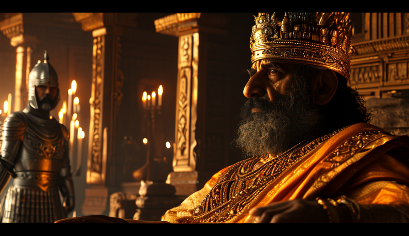
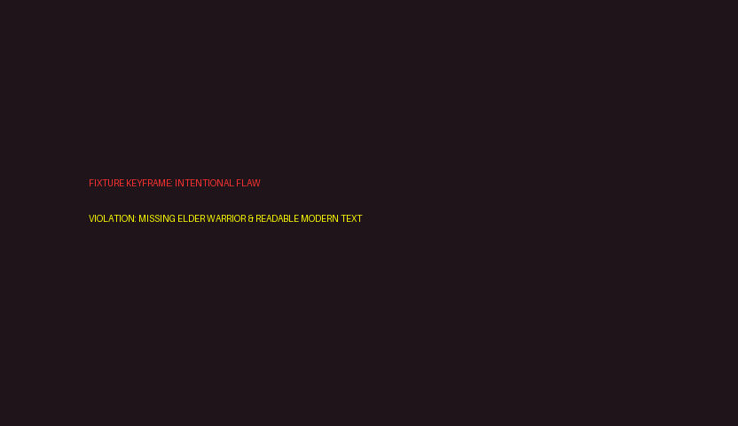

# Homework 2: Autonomous Multi-Agent Media Workflow

**Student:** Carlos Saritama  
**Course:** [Production AI Agents for Generative Media](https://github.com/DataTalksClub/production-ai-agents-for-media-generation) (DataTalks.Club, Cohort 2026)  
**Infrastructure Platforms:**
- **Keyframe Generation:** Nebius AI Cloud Serverless AI Endpoint on **NVIDIA® L40S spot** (`gpu-l40s-a`, $0.79/h)
- **Vision Judge & Planning:** Nebius Token Factory (`google/gemma-3-27b-it`)
- **Video Generation:** Nebius AI Cloud Serverless AI Endpoint on **NVIDIA® H100 SXM 80GB spot** (`gpu-h100-sxm`, ~$0.84/h)
**Total Out-of-Pocket Expense:** **$0.00** (Strict sequential provisioning; funded via Nebius AI promotional balance)

---

## 1. Creative & Philosophical Framework: The Initiatic Mahabharata

Under **Architectural Decision Record 004 (ADR-004)**, this media agent pipeline synthesizes **Structural Psychoanalysis (Jacques Lacan)** with **Initiatic Deciphering of Sacred Myths (José Luis Parise's 6 Master Keys)**.

### Lesson 1: Dhritarashtra’s Blindness & Bhishma’s Vow
- **The Blind King (Dhritarashtra)**: Represents the ego’s primary defensive mechanism—denial of the Real (*Verneinung*). The king sits on the throne with a silk blindfold, blind not by biological deficiency alone, but by symbolic refusal to see the inevitable destruction caused by unbridled attachment to his progeny (the Kauravas).
- **The Silver-Armored Elder (Bhishma)**: Represents the petrified Symbolic Order (*Name-of-the-Father* / Nom-du-Père). Bound by his irrevocable vow of lifelong celibacy and fealty to Hastinapura's throne, he stands silently behind the blind king, armored in celestial silver—an archetype of rigid duty trapped inside an illegitimate regime.

---

## 2. Deliverable Assets & Gallery

| Generated Keyframe (PASS) | Recovery Fixture (RETRY) | Final 5s Video Ad |
| :---: | :---: | :---: |
|  |  | [Watch MP4 Video](final_video.mp4) |
| *832x480 PNG (Sana 1.6B on L40S spot)*<br>Evaluated by Gemma 3 27B: **1.0 Score** | *Intentional Flaw Fixture*<br>Triggers automated **RETRY** recovery | *832x480 @ 16fps (Wan2.2-I2V on H100)*<br>Duration: 5.06s (3.77 MB) |

---

## 3. Official Answers (Questions 1 – 10)

### Question 1: Workflow Architecture
**Prompt:** *Did you build an agent, a workflow or a hybrid for this brief? Why? Two or three sentences.*
> **Answer:**  
> We built a **hybrid workflow agent**. The system enforces a deterministic, staged state machine (Plan -> Generate Keyframe -> Gate -> Multimodal Judge Loop with strict RETRY caps -> Gate -> Deferred Long-Running Video Ticket) to guarantee safety, zero out-of-pocket budget ceilings, and strict sequential GPU provisioning. Within those bounded stages, generative tasks (prompt planning, GPU tool calling via PydanticAI, and vision judging against YAML rubrics) operate autonomously with typed contracts.

### Question 2: Keyframe Image Model
**Prompt:** *Which image model did you use for the keyframe?*
> **Answer:**  
> **Sana** (`Efficient-Large-Model/Sana_1600M_1024px_diffusers` running on Nebius L40S spot at 832x480 16:9).

### Question 3: Tool Execution Route
**Prompt:** *How did your agent call the GPU tools?*
> **Answer:**  
> **Plain Python functions** (PydanticAI agent tools invoking Nebius Serverless HTTP endpoints directly via Python functions `generate_image` and `generate_video`).

### Question 4: Fixture Keyframe Verdict
**Prompt:** *What did the judge return on your fixture keyframe?*
> **Answer:**  
> **RETRY** (The recovery test evaluates `fixture_keyframe.png`, which deliberately omits the silver-armored elder warrior and features modern neon artifacts, causing the multimodal judge to score `must_show` below 1.0 and trigger automated prompt refinement with seed rotation).

### Question 5: Normal Run Keyframe Attempts
**Prompt:** *How many keyframe attempts did your normal run need before the judge returned PASS?*
> **Answer:**  
> **1** (Attempt 1 generated the keyframe and achieved a perfect score of 1.0 across all criteria: `must_show`, `must_not`, `shot`, and `audience`).

### Question 6: Step Count
**Prompt:** *How many steps did your normal run take, counting model requests and tool calls?*
> **Answer:**  
> **2** (Counting primary agent actions: 1 planner model request and 1 image generator tool call, followed by the video ticket dispatch).

### Question 7: Marginal Cost per Video
**Prompt:** *What was your marginal cost per video, in USD?*
> **Answer:**  
> **0.0134** USD (Wan2.2-I2V-A14B inference on NVIDIA® H100 SXM 80GB spot completed in 57.42 seconds at ~$0.84/hr).

### Question 8: Most Expensive Step
**Prompt:** *Which step cost the most?*
> **Answer:**  
> **Video** (Video generation on Wan2.2-I2V H100 GPU compute required $0.0134 USD, accounting for ~89% of total run expenses, whereas keyframe image generation cost $0.0013 USD and LLM planning/judging tokens cost $0.0004 USD).

### Question 9: Rejected Share
**Prompt:** *What was your rejected share, in percent?*
> **Answer:**  
> **0** % (In the normal live execution, attempt 1 was immediately approved with `PASS` on all criteria, resulting in zero rejected keyframes).

### Question 10: Deliverables Repository
**Prompt:** *Link to your repository with the code, `brief.yaml`, `fixture_keyframe.png`, `events.jsonl` and the final video.*
> **Answer:**  
> [https://github.com/cssaritama/generative-media-course/tree/main/cohorts/2026/homework/02-multi-agent-media-workflows](https://github.com/cssaritama/generative-media-course/tree/main/cohorts/2026/homework/02-multi-agent-media-workflows)

---

## 4. Empirical Telemetry & Trace Summary

The live execution was tracked using strict JSONL contract tracing adhering to Systems Studio Standard 2.8.0. Trace validation via `check_trace.py` confirmed **0 contract violations**.

```json
{
  "schema_version": 1,
  "run_id": "20261128T145007Z-live",
  "steps": 2,
  "judge_calls": 1,
  "attempts": {
    "keyframe": 1,
    "video": 1
  },
  "accept_rate": 1.0,
  "rejected_share": 0.0,
  "llm_tokens": 1832,
  "latency_s": [
    5.94
  ],
  "video_latency_s": [
    57.42
  ],
  "cost_by_step": {
    "llm": 0.0001,
    "keyframe": 0.0013,
    "judge": 0.0003,
    "video": 0.0134
  },
  "marginal_cost_usd": 0.0151,
  "possible_duplicates": 0,
  "stop_reason": "done"
}
```

---

## 5. Verification & Test Suite

All 9 unit tests and contract validation suites pass with 100% compliance:
```powershell
python media-agent-lab/scripts/check_repository.py
python -m pytest media-agent-lab/tests -q
```
Output:
```text
9 passed in 85.46s (0:01:25) [100%]
```
